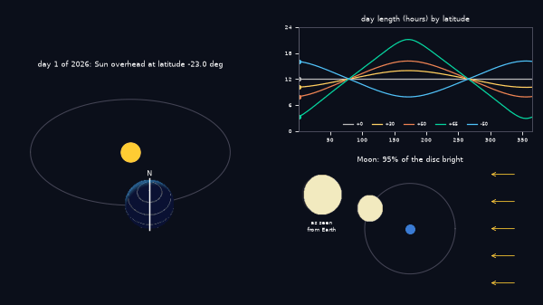
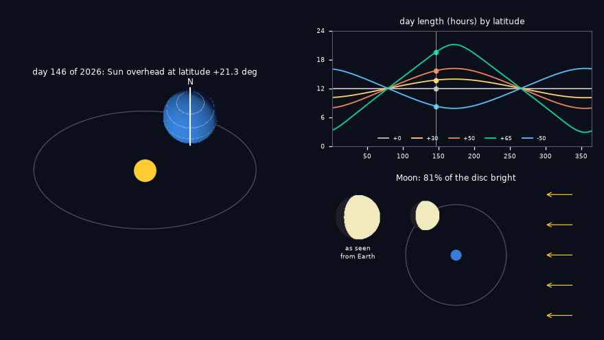
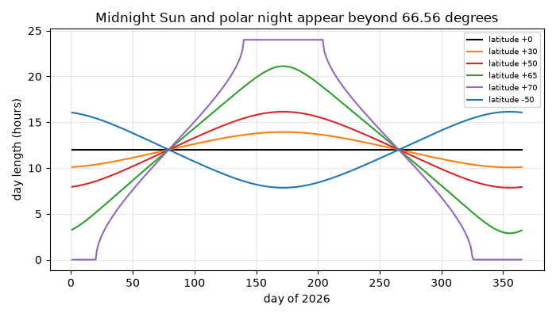
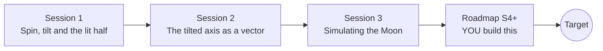

# openseasons

[](https://github.com/KrunalPanchal1995/openseasons/actions/workflows/ci.yml)   [](https://colab.research.google.com/github/KrunalPanchal1995/openseasons/blob/main/sessions/session-01/lesson.ipynb) [](https://krunalpanchal1995.github.io/openseasons/)

**Why we have day, night, seasons and Moon phases: geometry you can compute.**

openseasons teaches how a spinning, tilted Earth and a lit Moon make day, night, seasons and phases, using only vectors, angles, Python and a browser.

- **Start from a ball and a lamp.** Session 1 needs only school trigonometry; every symbol is explained.
- **See the tilt.** Each session ships a slider app with labelled graphs, from the orbit picture to the Moon's phases.
- **Check against the sky.** Checkpoints compare your numbers with hand calculations and with the real 2026 solstices, full Moons and eclipse dates.
- **Build the missing half.** The repo stops at Session 3 on purpose; the roadmap shows the path to the Target.

[Target](#the-target) · [Who is this for](#who-is-this-for) · [Quick start](#quick-start) · [Sessions](#sessions) · [Roadmap](#roadmap) · [Contribute](#contribute) · [Explainer PDF](docs/explainer.pdf)

> **This repo is incomplete on purpose.** Sessions 1 to 3 are here and fully working. The finished Target below is a preview of what the community can build next. We show you the path, not the code. Sessions 4 and up are yours.

## The Target

The Earth circles the Sun on a tilted axis while the day-night line (the terminator) sweeps across it. A second panel draws the length of the day against the date for several latitudes, with a moving marker, and a third shows the Moon going round the Earth with its phase disc updating. Your goal over the coming sessions: build all three panels yourself from the roadmap, and make them agree with the almanac.



*Target: tilted Earth orbiting the Sun with the day-night line, the day-length curve, and the Moon's phase disc*



*Target, still frame: northern midsummer*



*Day length through 2026 at five latitudes, including midnight Sun and polar night*

Try it live:

- [Math Visual Studio (Studio root)](https://krunalpanchal1995.github.io/studio/)

How the Target was made is shown only as a path in [promo/roadmap.md](promo/roadmap.md).

## Who is this for
**secondary school to diploma / undergraduate (levels 3-5).** Topic area: Astronomy and Space Science.

Prerequisites:

- Sine, cosine and angles (school trigonometry); Session 2 uses the dot product of two vectors and it is explained there.
- Python 3.10 or newer; if `python --version` works, you are ready. PRIMER.md explains the rest.
- No prior GitHub, astronomy or physics experience is needed.

New to Python? Read [PRIMER.md](PRIMER.md) first (10 minutes).

## Quick start

No installation knowledge needed. You need [Git](https://git-scm.com/downloads) and [Python 3.10+](https://www.python.org/downloads/) (Windows: tick "Add Python to PATH"). On Mac and Linux type `python3` wherever this page says `python`.

```bash
git clone https://github.com/KrunalPanchal1995/openseasons.git
cd openseasons
python start.py 1
```

`start.py` creates a private environment, installs what is needed and runs Session 1 with its checkpoint. Next: `python start.py 2`, `python start.py 3`, or `python start.py test` to check everything. Only a checkpoint: `python start.py check 1`.

Four lines turn the idea of Session 1 into a result (they work as they are): Save it as `try.py` and run it with `python start.py run try.py` (this uses the private environment, where NumPy is installed):

```python
import numpy as np
tilt, lat = 23.4, 40.0                          # degrees
print('noon Sun height, 21 June    :', 90 - lat + tilt)    # -> 73.4
print('noon Sun height, 21 December:', 90 - lat - tilt)    # -> 26.6
```

Every session also opens in your browser with sliders (no install): [live apps](https://krunalpanchal1995.github.io/openseasons/). Or use the Colab badge above for the notebook.

## Sessions

| # | Session | Model level | Time | Live app |
|---|---|---|---|---|
| 1 | [Spin, tilt and the lit half](sessions/session-01/README.md) | Level 1: conceptual interactive model | 60 min | [open](https://krunalpanchal1995.github.io/openseasons/session-01/) |
| 2 | [The tilted axis as a vector](sessions/session-02/README.md) | Level 2: mathematical engineering model | 75 min | [open](https://krunalpanchal1995.github.io/openseasons/session-02/) |
| 3 | [Simulating the Moon](sessions/session-03/README.md) | Level 3: simulation and validation | 90 min | [open](https://krunalpanchal1995.github.io/openseasons/session-03/) |

Each session follows the same six steps: A real-world problem, B concept and theory, C visual explanation, D interactive simulation, E worked example and experiment, F assessment and design challenge. Each ends with `checkpoint.py`, which prints `PASS` or `FAIL` against reference numbers. Session 3 also contains the real-world mini-project: **A year table for your latitude**.

## Architecture



| Folder or file | What is inside |
|---|---|
| `sessions/` | three sessions: README (A-F), `lesson.py`, notebook, live app, exercises, activity sheet, checkpoint |
| `promo/` | the Target: media, live links, and the roadmap (path only) |
| `docs/` | `explainer.tex` and the built `explainer.pdf` |
| `tests/` | runs every lesson and checkpoint headless |
| `start.py` | one command to set up and run anything |
| `QUALITY.md`, `RUBRIC.md` | the quality checklist and the scoring rubric |
| `.github/` | CI, PDF build, Pages deploy, issue and PR templates |

## Roadmap

| Milestone | What you will build | Difficulty |
|---|---|---|
| Session 4: A truer Moon calendar | A phase calendar that adds the largest periodic terms. | advanced |
| Session 5: Moonrise for a real place | A moonrise calculator for a latitude, using the Moon's declination from the 5.145 degree tilt. | intermediate |
| Session 6: The analemma | A figure-eight of the Sun's position at a fixed time through the year. | intermediate |
| Session 7: Kepler orbit instead of a series | An Earth-Sun distance and speed from the eccentricity 0.0167 by a numerical solver. | advanced |
| Session 8: Animate the whole sky | A looping animation like the Target, with the Earth, the day-length curves and the Moon disc together. | advanced |

Full detail with a checkpoint per milestone: [promo/roadmap.md](promo/roadmap.md).

## Contribute
New to GitHub? Read [CONTRIBUTING.md](CONTRIBUTING.md); it starts from zero. Pick an issue labelled `good first issue`. Translations into Hindi, Telugu, Tamil and Malayalam are welcome.

<details>
<summary>Development</summary>

```bash
python start.py test        # runs every lesson and checkpoint
```
Lessons use `# %%` cell markers so they open as notebooks in VS Code. See [QUALITY.md](QUALITY.md) for the standard every session meets.
</details>

## License
MIT. See [LICENSE](LICENSE). Media in `promo/media` is (c) Krunal Panchal, CC BY 4.0.

## Acknowledgments
Part of the [PAN IIT OSS](https://hellofoss.tech-iitb.org/projects) open-source teaching collection, modelled on the structure of [openspline](https://github.com/openspline/openspline). Built on ideas from the Math Visual Studio at https://krunalpanchal1995.github.io/studio/.
