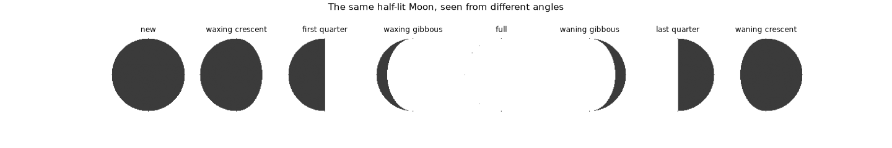
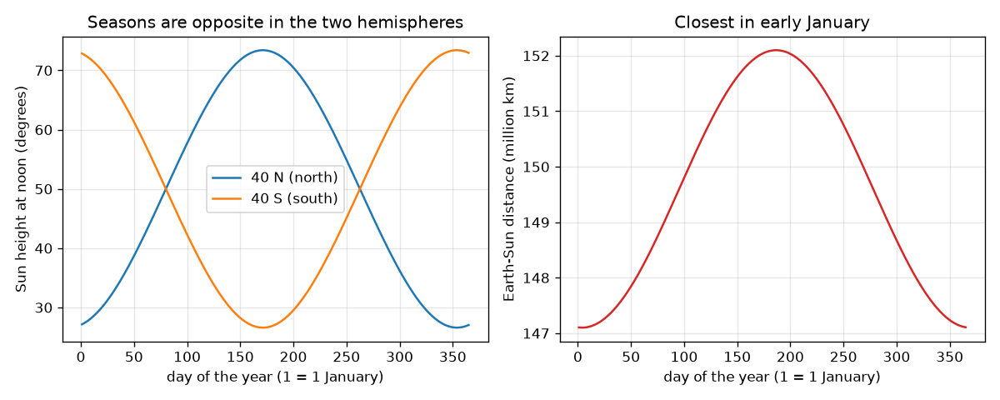

# Session 1: Spin, tilt and the lit half

*Level 1 (conceptual interactive model) · about 60 minutes · openseasons*

> This is a simplified educational model. It is not a validated design tool and must not be used for real structures, electrical installations, vehicles, industrial processes or medical decisions.

**Prerequisites**

- School trigonometry: sine and cosine of an angle.
- You have read PRIMER.md and run `python start.py 1` once.

**Learning objectives.** After this session you can:

- Explain day and night as the Earth spinning under a Sun that lights one half.
- Explain seasons with the 23.4 degree tilt, and say why distance is not the cause.
- Compute the noon Sun height for a latitude and a date.
- Explain Moon phases as how much of the Moon's lit half we see.

## A. Real-world problem
In early January the Earth is closest to the Sun, yet it is winter in India, Europe and North America and summer in Australia and Argentina. Why do we have day and night, why is June hot and December cold at your latitude, and why does the Moon grow from a thin crescent to a full disc? Three simple geometrical ideas explain all of it, and you can test each with a number.

## B. Concept and theory
A place is in daylight when its up direction points towards the Sun: the dot product of the up vector and the Sun direction is positive. As the Earth spins (15 degrees per hour) the place goes round a circle of latitude, half of it in light for a tilt of zero, so every day has 12 hours. The axis is tilted by 23.4 degrees from the line at right angles to the orbit and keeps pointing the same way in space. So the latitude where the Sun is overhead (the declination d) swings between +23.4 and -23.4 degrees over a year. At noon the Sun height is 90 - |latitude - d|. The Earth-Sun distance changes only from 147.1 to 152.1 million km, smallest on about 4 January, and it is the same for both hemispheres while their seasons are opposite. The Moon is always lit on one half by the Sun; the elongation D (angle Sun-Earth-Moon) decides how much of that half faces us, k = (1 - cos D) / 2.

| Symbol | Meaning | Unit |
|---|---|---|
| tilt | tilt of the Earth's axis from the orbit normal (23.4) | degrees |
| lat | latitude of a place (north positive) | degrees |
| d | declination: latitude where the Sun is overhead | degrees |
| n | day of the year (1 January = 1) | days |
| r | Earth-Sun distance | million km |
| D | elongation Sun-Earth-Moon | degrees |
| k | bright fraction of the Moon's disc | no unit |

**Assumptions**

- The Sun is so far away that its rays are parallel.
- The orbit is nearly a circle; the distance formula is a first-order approximation.
- Sun is a point and air does not bend its light (geometric day).
- The Moon's phase uses a constant speed of 360 degrees in 29.53 days.

$$ \hat n\cdot\hat s>0\ \Longleftrightarrow\ \text{daylight} $$

$$ \sin d=\sin(\text{tilt})\,\sin\!\left(\frac{2\pi(n-80)}{365.25}\right) $$

$$ \text{noon height}=90^\circ-|\text{lat}-d| $$

$$ r=149.6\left(1-0.0167\cos\frac{2\pi(n-4)}{365.25}\right)\ \text{million km} $$

$$ k=\frac{1-\cos D}{2} $$

## C. Visual explanation
The left figure plots the noon Sun height through the year at 40 N and 40 S: the two curves are mirror images, high in June in the north and in December in the south. The right figure plots the distance: it is smallest in early January, exactly when the northern curve is at its lowest. The second figure shows the same half-lit Moon at eight elongations; the bright shape changes only because our viewing angle changes.

*The same half-lit Moon at eight elongations, computed from a dot product.*

*Noon Sun height at 40 N and 40 S (mirror images) and the Earth-Sun distance (smallest in early January).*

## D. Interactive simulation
Run the lesson (`python start.py 1`), then open the live app: [Session 1: tilt, seasons and distance](https://krunalpanchal1995.github.io/openseasons/session-01/) (or `app.html` in this folder). Drag the day slider and watch the Earth go round with its axis pointing the same way; open the noon-height view and compare the two hemispheres; then set the tilt to 0 and see the seasons disappear.

**Challenge.** Make the Sun exactly overhead at noon (height at least 89 degrees) on day 172.

## E. Worked example and experiment
**Problem.** Find the noon Sun height at latitude 40 N on 21 June and on 21 December, using a tilt of 23.4 degrees.

1. On 21 June the Sun is overhead at the declination d = +23.4 degrees.
2. Height = 90 - |40 - 23.4| = 90 - 16.6 = 73.4 degrees.
3. On 21 December d = -23.4 degrees, so height = 90 - |40 + 23.4| = 90 - 63.4 = 26.6 degrees.
4. The model code gives the same two numbers, and also the day length 14.84 h in June and 9.16 h in December.

**Answer.** 73.4 degrees in June and 26.6 degrees in December: a swing of 46.8 degrees, which is twice the tilt.

**Experiment.** Stand a 1 m stick upright on level ground at local noon on the two solstices (or on any two dates months apart) and measure the shadow length. Height = arctan(1 / shadow). Compare with the app. Differences come from the stick not being vertical, noon not being exactly noon by the clock, and the model's pointlike Sun; the model gives the geometry, not a measurement.

## F. Assessment and design challenge
**Question type A: Conceptual.** A friend says that summer is when the Earth is closest to the Sun. Give two pieces of evidence that this is wrong.

Hint

Compare the date of the smallest distance with the northern season, and think of the southern hemisphere on the same day.

Step-by-step solution

The smallest distance (147.1 million km) is on about 4 January, in northern winter, and the largest (152.1) is in early July, in northern summer. Also on one date the whole Earth is at one distance, but the two hemispheres have opposite seasons; on 4 January the noon Sun at 40 N is only 27.5 degrees high but at 40 S it is 72.5 degrees high. A cause that is the same for both cannot make them different.

**Question type B: Numerical.** Find the noon Sun height at 60 N on 21 June and on 21 December with tilt 23.4 degrees.

Hint

Height = 90 - |lat - d| with d = +23.4 and -23.4.

Step-by-step solution

June: 90 - (60 - 23.4) = 53.4 degrees. December: 90 - (60 + 23.4) = 6.6 degrees. Sanity check: the Sun is lower at higher latitude in both seasons, and the June value is higher than the December one.

**Question type C: Graph and simulation interpretation.** In the noon-height graph for 40 N and 40 S, at about which days do the two curves cross, and what is the height there?

Hint

They cross when both hemispheres get the same Sun, which means the Sun is over the equator.

Step-by-step solution

They cross at the equinoxes, around day 80 (20 March) and day 263 (23 September), where d is close to 0 and both heights are 90 - 40 = 50 degrees.

**Question type D: Design and optimisation challenge.** Design: you want a place where the noon Sun is never lower than 45 degrees at any time of the year. With tilt 23.4 degrees, what is the largest latitude (north or south)?

Hint

The lowest noon Sun happens in the winter of that hemisphere, 90 - lat - 23.4.

Step-by-step solution

We need 90 - lat - 23.4 >= 45, so lat <= 21.6 degrees. Within 21.6 degrees of the equator the noon Sun is always at least 45 degrees high. The trade-off: such places have almost no change in day length either, so they have little seasonal variation; the model ignores clouds and the atmosphere.

Score yourself with [RUBRIC.md](../../RUBRIC.md). Print the [activity sheet](activity_sheet.md) to work on paper.

## Common misconceptions
| Common misconception | What is actually true |
|---|---|
| Summer happens because the Earth is closer to the Sun. | The Earth is closest in early January. Seasons come from the tilt, which changes the Sun's noon height and the day length. |
| The Earth's axis tilts back and forth through the year. | The axis keeps pointing the same way in space; the Earth's position on the orbit changes which pole leans towards the Sun. |
| The Sun is overhead at noon everywhere in the tropics every day. | It is overhead only at latitude d, which moves between 23.4 N and 23.4 S during the year. |
| The Moon's phases come from clouds or from the Earth's shadow. | The Moon is always half lit; the phase is how much of that half faces us. |

## Glossary
- **axis tilt**: the angle between the Earth's spin axis and the line at right angles to its orbit, 23.4 degrees
- **declination**: the latitude where the Sun is overhead at noon
- **hour angle**: angle the Earth has turned since local noon, 15 degrees per hour
- **elongation**: angle Sun-Earth-Moon, 0 at new Moon and 180 at full Moon
- **terminator**: the line between day and night on the Earth or between the bright and dark parts of the Moon

## Finish
1. Do the three coding tasks in [exercises.md](exercises.md).
2. Run `python start.py 1` again after your changes. It ends with the checkpoint; when it prints `PASS`, you are done. (Checkpoint only: `python start.py check 1`.)

Next: [Session 2](../session-02/README.md)
