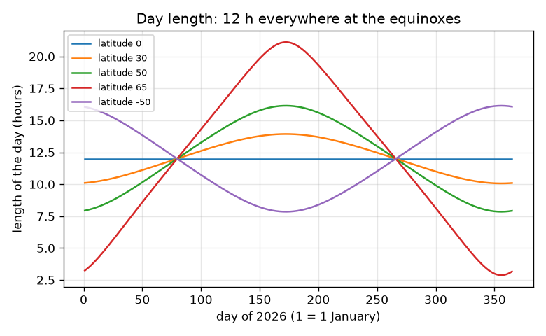
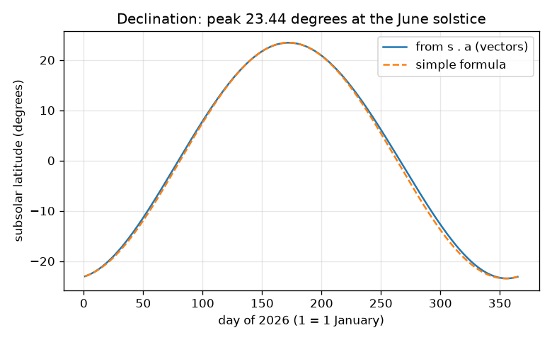
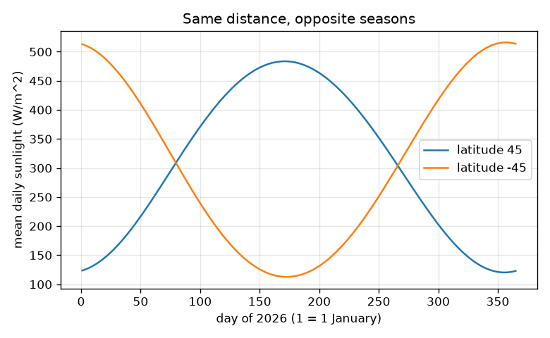

# Session 2: The tilted axis as a vector

*Level 2 (mathematical engineering model) · about 75 minutes · openseasons*

> This is a simplified educational model. It is not a validated design tool and must not be used for real structures, electrical installations, vehicles, industrial processes or medical decisions.

**Prerequisites**

- Session 1.
- The dot product of two vectors: a . b = |a||b| cos(angle between them); it is explained in Section B.
- The repo `opendaylight` shows the sun path through a day; this session does not repeat it.

**Learning objectives.** After this session you can:

- Derive the subsolar latitude (declination) from the dot product of the Sun direction and the spin axis.
- Compute day length, including midnight Sun and polar night, and check it by two methods.
- Use the inverse-square law to show that the 6.9 percent swing in sunlight cannot cause the seasons.
- Derive the 4 minute difference between the sidereal day and the solar day.

## A. Real-world problem
A solar-farm planner needs the length of the day, the noon Sun height and the daily sunlight for a latitude on any date of the year, and a colleague insists that the seasons come from the distance to the Sun, which changes by 5 million km. Can you build the numbers from vectors, verify them against an independent calculation and show, with data, which of the two causes wins?

## B. Concept and theory
Use axes with x towards the March equinox direction, y along the orbit plane and z at right angles to it. The spin axis keeps its direction in space: a = (0, sin T, cos T), with T = 23.44 degrees. The direction from the Earth to the Sun at ecliptic longitude lam is s = (cos lam, sin lam, 0). The latitude where the Sun is overhead has up direction s, and latitude is measured from the equator, so its sine is the dot product with the axis: sin d = s . a = sin T sin lam. This peaks at d = T at the June solstice (lam = 90). For a place at latitude phi, daylight needs cos(phi) cos(d) cos(h) + sin(phi) sin(d) > 0, which gives the sunrise hour angle cos(H0) = -tan(phi) tan(d) and a day of 2 H0 / 15 hours; a value of the right side of at least 1 means polar night and of at most -1 means polar day. The polar limit is the latitude 90 - T. The noon height is 90 - |phi - d|. The sunlight falls as 1/r^2; r goes from 0.98329 to 1.01671 AU (147.1 to 152.1 million km), so sunlight at perihelion is (152.1/147.1)^2 = 1.069 times that at aphelion. In one day the Earth turns 360 degrees relative to the stars but also moves 360/365.2422 = 0.9856 degrees round the Sun, so the solar day needs that much extra spin: 235.9 s.

| Symbol | Meaning | Unit |
|---|---|---|
| T | tilt of the axis | degrees |
| lam | ecliptic longitude of the Sun (0 at March equinox) | degrees |
| a, s | unit vectors: spin axis and direction to the Sun | no unit |
| d | declination = subsolar latitude | degrees |
| phi | latitude of a place | degrees |
| H0 | sunrise hour angle | degrees |
| r | Earth-Sun distance | AU (1 AU = 149.598 million km) |
| S0 | sunlight at 1 AU on a surface facing the Sun (1361) | W/m^2 |
| Q | mean daily sunlight on horizontal ground (top of the atmosphere) | W/m^2 |

**Assumptions**

- Low-precision formulas for the Sun (about 0.01 degrees); the tilt is constant at 23.44 degrees.
- The Sun is a point and there is no atmosphere: geometric day length, real days are a few minutes longer.
- Q is the sunlight at the top of the atmosphere, not what reaches the ground.
- Distances use the series r = 1.00014 - 0.01671 cos g - 0.00014 cos 2g.

$$ \sin d=\hat s\cdot\hat a=\sin T\,\sin\lambda $$

$$ \cos H_0=-\tan\phi\,\tan d,\qquad \text{day length}=\frac{2H_0}{15^\circ}\ \text{h} $$

$$ Q=\frac{S_0}{\pi r^2}\left(H_0\sin\phi\sin d+\cos\phi\cos d\sin H_0\right) $$

$$ \frac{S_{\text{peri}}}{S_{\text{aph}}}=\left(\frac{r_{\text{aph}}}{r_{\text{peri}}}\right)^2 $$

$$ \frac{1}{T_{\text{solar}}}=\frac{1}{T_{\text{sidereal}}}-\frac{1}{T_{\text{year}}} $$

## C. Visual explanation
The first figure plots the declination from the vector formula and from the simpler formula of opendaylight: they differ by at most 1.2 degrees and both peak at 23.44 degrees on day 172, the June solstice. The second figure shows the day length at five latitudes: it is 12 hours for everyone at the equinoxes and the curves separate with latitude, and the higher the latitude the larger the swing; the app lets you push a latitude into midnight Sun by raising the tilt or the latitude. The third figure shows the mean daily sunlight at 45 north and 45 south: the curves are mirror images with the southern peak a little higher because the Earth is nearer the Sun in January.

*Day length against date at five latitudes: 12 hours everywhere at the equinoxes.*

*Declination from the dot product and from the simple formula; the peak is 23.44 degrees at the June solstice.*

*Mean daily sunlight at 45 N and 45 S: opposite seasons at the same distance.*

## D. Interactive simulation
Run the lesson (`python start.py 2`), then open the live app: [Session 2: the tilted axis](https://krunalpanchal1995.github.io/openseasons/session-02/) (or `app.html` in this folder). Move the latitude and day sliders; watch the green line (the circle of latitude seen edge-on) enter the lit half; then raise the tilt and see the polar-day limit move.

**Challenge.** Find a setting with a 24 hour day (the Sun does not set) at a latitude below 70 degrees.

## E. Worked example and experiment
**Problem.** Find the declination, day length and noon Sun height at latitude 40 N on the June solstice (tilt 23.44 degrees).

1. At the solstice lam = 90 degrees, so sin d = sin 23.44 sin 90 = 0.3978 and d = 23.44 degrees.
2. cos H0 = -tan 40 tan 23.44 = -0.8391 * 0.4336 = -0.3638, so H0 = 111.33 degrees.
3. Day length = 2 * 111.33 / 15 = 14.84 hours.
4. Noon height = 90 - |40 - 23.44| = 73.44 degrees.
5. Check: counting the part of a latitude circle with a positive dot product gives the same 14.84 hours, and the maximum of that dot product gives the same 73.44 degrees.

**Answer.** d = 23.44 degrees, day length 14.84 hours, noon height 73.44 degrees.

**Experiment.** Record the sunrise and sunset times for your town from a newspaper or an almanac at the solstices and the equinoxes and compare with the model. Almanac days are a few minutes longer (air bends the light and the Sun has a disc), and differ more at high latitude: the model is a geometric ideal, the sky is not.

## F. Assessment and design challenge
**Question type A: Conceptual.** Explain in words why the dot product of the Sun direction with the spin axis is the sine of the latitude where the Sun is overhead.

Hint

At the subsolar point the up direction is the Sun direction. How is latitude related to the angle between up and the axis?

Step-by-step solution

Latitude is the angle above the equator, and the equator is the plane at right angles to the axis. For a unit up vector u, the dot product u . a = cos(angle from the axis) = sin(latitude). At the subsolar point u is the unit Sun direction s, so sin d = s . a. Since s = (cos lam, sin lam, 0) and a = (0, sin T, cos T), the dot product is sin T sin lam.

**Question type B: Numerical.** Find the day length at 50 N on the June solstice (d = 23.44 degrees) and the noon Sun height.

Hint

cos H0 = -tan 50 tan 23.44, then day = 2 H0 / 15.

Step-by-step solution

cos H0 = -1.1918 * 0.4336 = -0.5168, so H0 = 121.1 degrees and the day is 2 * 121.1 / 15 = 16.15 hours. The noon height is 90 - (50 - 23.44) = 63.44 degrees. Sanity check: longer than 14.84 h at 40 N, as expected at higher latitude in summer.

**Question type C: Graph and simulation interpretation.** From the sunlight graph for 45 N and 45 S, why is the southern summer peak (510 W/m^2) higher than the northern (478 W/m^2)? Does it explain the seasons?

Hint

Compare the Earth-Sun distance in January and July.

Step-by-step solution

In January the Earth is nearer the Sun (147.1 against 152.1 million km), so the 1/r^2 factor, up to 1.069, raises the southern peak. But the winter-to-summer change in each hemisphere (126 to 478 W/m^2 in the north) is a factor of about 3.8, far larger than 1.069, and its sign is opposite in the two hemispheres. So the tilt makes the seasons and distance only modifies them by a few percent.

**Question type D: Design and optimisation challenge.** Design: an amateur astronomer wants to keep a star centred. How much earlier does a star rise by the clock each solar day, and how much earlier after 30 days? Why does the sky of a season change?

Hint

Use the 235.9 s per day difference between solar and sidereal days.

Step-by-step solution

A star rises 235.9 s (3 min 56 s) earlier each day. After 30 days: 30 * 235.9 s = 7077 s = 118 minutes, nearly 2 hours. So the stars you see at 9 pm shift: after half a year they are 12 hours different, which is why the constellations change with the seasons.

Score yourself with [RUBRIC.md](../../RUBRIC.md). Print the [activity sheet](activity_sheet.md) to work on paper.

## Common misconceptions
| Common misconception | What is actually true |
|---|---|
| The Sun is overhead at the equator at every noon. | Only at the equinoxes; its latitude is the declination, which moves between 23.44 N and 23.44 S. |
| Day and night are equal everywhere on one date only at the equator. | At the equinox the geometric day is 12 hours at every latitude (the poles are a special case). |
| More sunlight in a hemisphere means closer to the Sun. | On 4 January 45 S gets four times the sunlight of 45 N at the same distance; the tilt decides who gets more. |
| A day is the time for one full turn of the Earth. | One full turn (sidereal day) is 23 h 56 m 4.1 s; the solar day is longer by 235.9 s because the Earth also moved along its orbit. |

## Glossary
- **ecliptic longitude**: angle of the Sun along the orbit plane measured from the March equinox direction
- **subsolar point**: the place where the Sun is exactly overhead
- **perihelion and aphelion**: the closest and the farthest point of the orbit from the Sun
- **sidereal day**: time for one turn relative to the stars, 86164.1 s
- **inverse-square law**: the Sun's light spread over a sphere falls as 1 / r^2
- **astronomical unit (AU)**: mean Earth-Sun distance, 149.598 million km

## Finish
1. Do the three coding tasks in [exercises.md](exercises.md).
2. Run `python start.py 2` again after your changes. It ends with the checkpoint; when it prints `PASS`, you are done. (Checkpoint only: `python start.py check 2`.)

Next: [Session 3](../session-03/README.md)
