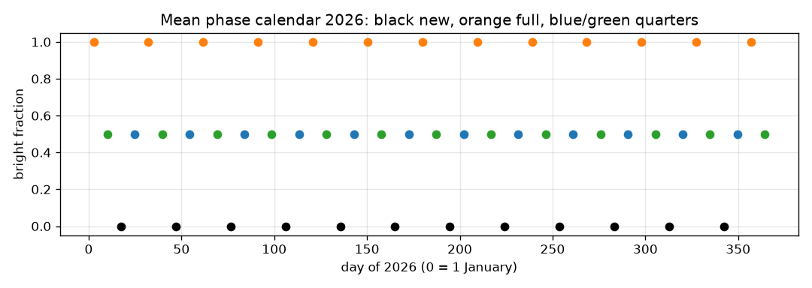
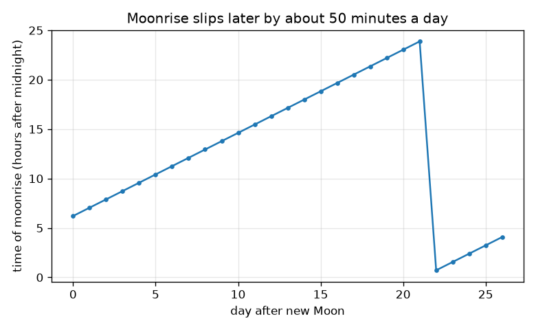
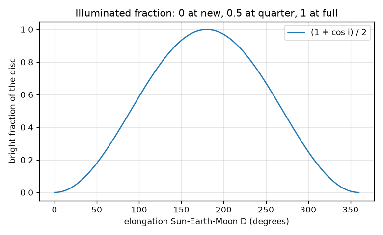

# Session 3: Simulating the Moon

*Level 3 (simulation and validation) · about 90 minutes · openseasons*

> This is a simplified educational model. It is not a validated design tool and must not be used for real structures, electrical installations, vehicles, industrial processes or medical decisions.

**Prerequisites**

- Sessions 1 and 2.
- Angles, the dot product, and a first look at random numbers (explained in Section B).

**Learning objectives.** After this session you can:

- Compute the illuminated fraction k = (1 + cos i) / 2 from the Sun-Moon-Earth geometry and verify it at new, quarter and full.
- Derive the synodic month 29.53 days from the sidereal month and the year, and the 50 minute daily moonrise delay.
- Simulate a phase calendar for 2026 and state its error against the almanac.
- Explain why eclipses are rare (the 5.1 degree tilt) and why the Earth's shadow cannot make the phases.

## A. Real-world problem
A school wants a printed Moon calendar for 2026 and a table of day length, noon Sun height and Moon phase for its latitude. People also ask why there is not an eclipse every month and whether the Moon's phases are the Earth's shadow. Can you simulate the angles, compare with the almanac, state the error and answer both questions with numbers?

## B. Concept and theory
The phase angle i is the angle at the Moon between the directions to the Sun and to the Earth. The bright fraction is k = (1 + cos i) / 2: 0 at new (i = 180), 0.5 at the quarters (i = 90) and 1 at full (i = 0). Because the Sun is 389 times farther than the Moon, i is almost exactly 180 - D, where D is the elongation. The Moon needs 27.32 days (sidereal month) to return to the same star, but the Earth has moved on, so the Moon must go further to catch up with the Sun; in one day the cycle gains 1/T_sid - 1/T_year, giving 1/T_syn = 1/T_sid - 1/T_year and T_syn = 29.5306 days. The elongation grows 360/29.5306 = 12.19 degrees a day (0.508 degrees an hour). A Moon on the celestial equator rises when its hour angle is -90 degrees; the Sun's hour angle grows 15 degrees an hour and D is growing, so the delay between moonrises is 12.19 / (15 - 0.508) = 0.841 h = 50.5 minutes, equal to 24 h * 29.53 / 28.53 - 24 h. The Moon's orbit is tilted 5.145 degrees to the Earth's, so at new or full its ecliptic latitude is asin(sin(5.145) sin(u)), where u is its angle from the node. An eclipse is possible only if the latitude is below about 1.48 degrees (the two angular radii plus the Moon's parallax), which happens for 2 asin(1.48 / 5.145) / pi = 18.5 percent of new Moons if u is random. Finally the Earth's umbra has radius 4600 km at the Moon's distance, 2.65 Moon radii, and lies on the line from the Sun through the Earth.

| Symbol | Meaning | Unit |
|---|---|---|
| D | elongation Sun-Earth-Moon | degrees |
| i | phase angle Sun-Moon-Earth | degrees |
| k | bright fraction of the disc | no unit |
| T_sid, T_syn, T_year | sidereal month 27.321662, synodic month, sidereal year 365.25636 | days |
| u | Moon's angle from a node of its orbit | degrees |
| beta | Moon's ecliptic latitude | degrees |
| epsilon | tilt of the Moon's orbit, 5.145 | degrees |
| delay | extra time between moonrises | minutes |

**Assumptions**

- Mean motion: the Moon's speed is treated as constant, so the real phase can differ from the model by up to about 14 hours.
- Reference mean new Moon: 6 January 2000, 14 h (days since J2000 = 5.09766).
- For moonrise the Moon is on the celestial equator; the real delay varies from night to night.
- Eclipse chance is a rough count using mean sizes; it does not predict which eclipses are total or annular.
- All times are UT, and the year table uses noon UT.

$$ k=\frac{1+\cos i}{2},\qquad i\approx 180^\circ-D $$

$$ \frac{1}{T_{\text{syn}}}=\frac{1}{T_{\text{sid}}}-\frac{1}{T_{\text{year}}} $$

$$ \text{delay}=\frac{360/T_{\text{syn}}}{15-360/(24\,T_{\text{syn}})}\ \text{h} $$

$$ \beta=\arcsin\!\left(\sin\epsilon\,\sin u\right),\qquad P=\frac{2}{\pi}\arcsin\frac{\beta_{\max}}{\epsilon} $$

$$ R_{\text{umbra}}=R_E-d\,\frac{R_S-R_E}{D_{\text{Sun}}} $$

## C. Visual explanation
The first figure plots the bright fraction against the elongation: a smooth curve from 0 (new) up to 1 (full) and back, passing 0.5 at the quarters. The second marks the new, quarter and full Moons of 2026 from the simulation. The third plots the moonrise time against the Moon's age: a rising line, with a slope of about 50 minutes per day, that wraps past midnight.

*Mean-motion phase calendar for 2026 from the simulation.*

*Moonrise time against the Moon's age: about 50 minutes later each day.*

*Bright fraction against elongation: 0 at new, 0.5 at the quarters, 1 at full.*

## D. Interactive simulation
Run the lesson (`python start.py 3`), then open the live app: [Session 3: Moon phases, moonrise, eclipses](https://krunalpanchal1995.github.io/openseasons/session-03/) (or `app.html` in this folder). Move the age slider and watch the Moon go round the Earth while the disc seen from Earth updates; switch to the moonrise plot; then reduce the tilt of the Moon's orbit and watch the share of new Moons near a node rise.

**Challenge.** Find a half-lit Moon and a tilt so small that at least 40 percent of new Moons would be near a node.

## E. Worked example and experiment
**Problem.** Derive the synodic month from a sidereal month of 27.321662 days and a sidereal year of 365.25636 days.

1. 1 / 27.321662 = 0.036601 per day and 1 / 365.25636 = 0.002738 per day.
2. The difference is 0.033864 per day.
3. T_syn = 1 / 0.033864 = 29.5306 days.
4. The accepted mean synodic month is 29.530589 days: the model is within 0.001 day.

**Answer.** T_syn = 29.5306 days, about 29 days 12 hours 44 minutes.

**Experiment.** Keep a Moon diary: note the date and look of the Moon at the same time each evening for a month and mark the full Moons. Compare with the simulation calendar: the model full Moons are within 0.3 day of the almanac on 3 January, 3 March, 31 May and 28 August 2026. The difference is the real Moon's changing speed, which the mean motion ignores, and your reading of 'full'.

## Real-world application and mini-project: A year table for your latitude
Choose a latitude (we use 60 degrees north as the example; use your own town too). With `year_table` from Session 3, build the table of day length, noon Sun height and Moon phase for the 21st of every month of 2026, and add the rows for the nearest full Moon dates.

**Deliverable:** A script that prints the 12-row table, names the longest and shortest day with their noon Sun heights, finds the first 21st on which the day exceeds 15 hours, saves a plot of day length against month, and checks that the table is consistent: day and night within 0.1 hour of equal at the equinoxes.

**Success looks like:** At 60 N the longest day is 21 June with 18.49 hours and a noon Sun height of 53.4 degrees; the shortest is 21 December with 5.51 hours and 6.6 degrees; the first 21st above 15 hours is in May.

## F. Assessment and design challenge
**Question type A: Conceptual.** Explain why the Earth's shadow cannot be the cause of the Moon's phases, using the shadow size and the geometry at first quarter.

Hint

Where is the shadow, and where is the Moon at quarter?

Step-by-step solution

The Earth's shadow points straight away from the Sun, and at the Moon's distance its dark core has a radius of about 4600 km. At first quarter the Moon is 384400 km sideways from the line through the Sun and the Earth, 84 times the shadow radius, far outside it. The shadow can touch the Moon only within 0.94 degrees of full Moon (about 3.7 hours a month) and then only if the Moon is also near a node. So the shadow causes lunar eclipses, not phases.

**Question type B: Numerical.** At what Moon age is exactly 25 percent of the disc bright, in the first half of the month?

Hint

Solve (1 - cos D) / 2 = 0.25, then age = D / 360 * 29.53.

Step-by-step solution

cos D = 0.5, so D = 60 degrees and age = 60 / 360 * 29.53 = 4.92 days. Sanity check: between new Moon (0) and first quarter (7.38 days).

**Question type C: Graph and simulation interpretation.** From the moonrise graph, when does the Moon rise on the night of new Moon and on the next night? What does the slope tell you?

Hint

Read the first two points and subtract.

Step-by-step solution

At new Moon it rises at about 6.2 h (just after sunrise) and the next day at about 7.05 h. The slope is 0.84 h = 50.5 minutes per day: each day the Moon has moved 12.19 degrees further east and the Earth must turn that much more to bring it up.

**Question type D: Design and optimisation challenge.** Design: a model Moon orbit has a tilt such that one new Moon in three would be near a node. What tilt is that, and what does it say about eclipses in a world with such a tilt?

Hint

Set 2 asin(1.4763 / tilt) / pi = 1/3.

Step-by-step solution

asin(x) = pi/6 so x = 0.5 and tilt = 1.4763 / 0.5 = 2.95 degrees. A smaller tilt means more frequent eclipse seasons; with the real 5.145 degrees the share is 18.5 percent, about one new Moon in 5.4. The model counts only the chance of a possible eclipse, not its type.

Score yourself with [RUBRIC.md](../../RUBRIC.md). Print the [activity sheet](activity_sheet.md) to work on paper.

## Common misconceptions
| Common misconception | What is actually true |
|---|---|
| The phases are caused by the Earth's shadow. | The shadow is tiny and far from the Moon at quarter; phases are the changing view of the lit half. |
| There should be an eclipse at every new and full Moon. | The Moon's orbit is tilted 5.145 degrees, so it usually passes above or below the Sun-Earth line. |
| The Moon goes round the Earth in 29.53 days. | It does a full turn relative to the stars in 27.32 days; 29.53 days is the time to return to the same phase. |
| The model dates are exact. | Mean motion can be off by about 14 hours; in our check it was within 0.3 day. |

## Glossary
- **phase angle**: angle at the Moon between the directions to the Sun and to the Earth
- **synodic month**: time from one new Moon to the next, 29.53 days
- **sidereal month**: time for the Moon to return to the same star, 27.32 days
- **node**: a point where the Moon's orbit crosses the Earth's orbit plane
- **umbra**: the dark inner part of a shadow
- **mean motion**: motion at constant average speed

## Finish
1. Do the three coding tasks in [exercises.md](exercises.md).
2. Run `python start.py 3` again after your changes. It ends with the checkpoint; when it prints `PASS`, you are done. (Checkpoint only: `python start.py check 3`.)

Next: the [roadmap](../../promo/roadmap.md). Session 4 is yours to build.
